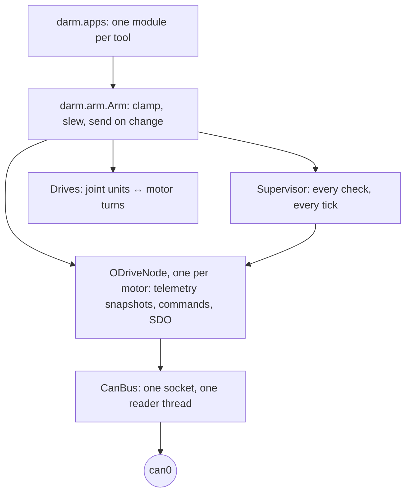

# dARM ODrive tools

Supervised CAN control and commissioning for robot arms built on ODrive S1 controllers, aimed at
**dARM2**: a metal, CNC-machined arm with 27:1 cycloidal drives. (The original 3D-printed
[dARM](https://github.com/JesseDarr/dARM) is retired.)

Everything specific to the arm (joints, gear ratios, limits, node ids, motor tuning) lives in one
file, [`darm.toml`](darm.toml). The code knows about joints, transmissions and ODrives in general,
and nothing about any one arm.

```
darm monitor      live telemetry, read-only
darm console      move joints from the keyboard
darm gamepad      move joints from a game controller
darm configure    write darm.toml's settings to the ODrives
darm calibrate    motor/encoder calibration, saved only on success
darm errors       read and clear ODrive errors
darm address      assign CAN node ids (after a firmware flash)
darm home         re-zero every joint at the dock
darm backup       dump every ODrive setting to JSON
darm exercise     sweep a joint through its range (spreads grease)
```

## Running it

Nothing to install. `darm` at the repo root is a Python script with a `#!/usr/bin/env python3`
shebang that runs the tools straight from this checkout. Python 3.10 or newer, plus the
libraries in `requirements.txt`:

```bash
# On the Pi, once (after enabling the CAN HAT, see "Setting up the Pi"):
scripts/setup_pi.sh               # can0 at boot, plus the libraries in .venv
source .venv/bin/activate
```

```powershell
# Anywhere else, e.g. to try every tool against simulated ODrives:
python -m venv .venv
.venv\Scripts\Activate.ps1        # bash: source .venv/bin/activate
pip install -r requirements.txt
```

Then:

```
./darm --help                every tool, one line each
./darm calibrate --help      one tool: what it does, why, and its options
./darm --sim console         any tool against simulated ODrives instead of the CAN bus
python darm --help           Windows, or anywhere the shebang doesn't apply
```

Tools use this repo's `darm.toml` from any directory; `--config` or `$DARM_CONFIG` points them at
another. `monitor`, `console` and `gamepad` take over the whole terminal, so run them in a real
terminal window. The examples in the rest of this README write `darm` for `./darm`.

## Before you flash

Flashing an ODrive erases its configuration, its calibration **and its node id**. A freshly
flashed ODrive sits silent on the bus until it is addressed again. Bring boards up in this order:

1. **Back up** boards that already hold a configuration (say, the old dARM's):
   `darm backup --firmware 0.6.10`
2. **Flash 0.6.12-1** to every ODrive. Not plain 0.6.12, which drops CAN frames under load.
3. `darm address`: blinks each ODrive's LED in turn, asks which node it is, and assigns the id
   by serial number.
4. `darm configure`: writes `darm.toml`'s settings, reads each one back, and saves.
   `--dry-run` shows what would change.
5. With the arm **docked and unloaded**: `darm calibrate 0 1 2 3 4 5 6`. Calibrating a loaded
   joint corrupts the encoder offset, which shows up later as spinout errors. Results are saved
   only when calibration succeeds.
6. `darm home`, then `darm monitor` to check every node and joint before moving anything.

## Safety model

The arm has no brakes. A motor that stops being driven lets its joint fall. Everything here
follows from that.

- **Nothing moves except through the arm.** Interfaces only say where they want a joint to be.
  The arm clamps that to the joint's limits, slews toward it no faster than the joint's
  `max_speed`, and sends a setpoint only when it changes. Held keys and sticks can't run a
  target more than a quarter second of travel ahead of the joint.
- **Everything is watched, 50 times a second.** Heartbeats, encoder freshness, ODrive errors,
  closed-loop state, FET temperature, bus voltage, current strain on the big motors, joint
  limits, and joints that stop short of their target.
- **Any problem freezes the arm.** Each joint brakes at its ODrive's own deceleration limit and
  holds there, powered. Nothing ever goes limp on its own. The fault stays latched, with the
  reason on screen, until you clear it, and clearing re-checks everything first.
- **Taking control never moves anything.** Arming holds every joint exactly where it is. The
  tools refuse to arm if an ODrive's `init_pos` would make it lunge, or if its watchdog would
  drop the arm whenever the host goes quiet.
- **Zero is the dock.** ODrives count position from wherever they powered up, so **always power
  on with the arm docked**. The host remembers whether the arm was left docked and refuses to arm
  after a power cycle anywhere else. `darm home` re-zeroes once the arm is back in the dock.
- **Only the dock lets go.** `park` folds the arm home one stage at a time (distal joints first)
  and releases the motors only once every joint is verified home.
- **Firmware is pinned.** Endpoint ids change between firmware builds (515 of 584 moved between
  0.6.10 and 0.6.12), so writing with the wrong table changes the wrong settings. Every tool
  checks every ODrive's version first.

Quitting a tool (`q`, Esc, Ctrl-C) leaves the arm **holding** its position. Use `p` to park.

## Setting up the Pi

1. Enable the CAN HAT. Append to `/boot/firmware/config.txt` and reboot:
   ```
   dtparam=spi=on
   dtoverlay=mcp2515-can0,oscillator=12000000,interrupt=25
   dtoverlay=spi0-hw-cs
   ```
   `dmesg | grep -i mcp251` should show the controller.
2. Clone this repo and run `scripts/setup_pi.sh`. It installs a service that brings `can0` up at
   boot (1 Mbit/s, automatic bus-off recovery, a 256-frame transmit queue) and puts the Python
   libraries darm needs into `.venv`.
3. `source .venv/bin/activate`, then `./darm monitor`. See [Running it](#running-it).

`scripts/reset_interfaces.sh` restarts CAN and Bluetooth without a reboot, then prints the bus
statistics. A climbing `rx_over_errors` count means the MCP2515 is dropping frames.

## Driving the arm

| Tool | Keys |
| --- | --- |
| `console` | ←/→ select joint · ↑/↓ 1° or 0.5 mm · PgUp/PgDn 10° or 5 mm |
| `gamepad` | hold the dead-man (LB) to move · add RB to move the wrist · triggers drive the gripper |
| both | Space freeze · `c` clear fault · `p` park and exit · `q` quit, holding |

Stick and button mappings are in `[gamepad]` in `darm.toml`. Losing the controller freezes the
arm.

## Configuration

[`darm.toml`](darm.toml) is the robot. It is validated completely on load. Unknown keys,
impossible limits, a joint missing from the park order and settings the firmware can't accept
are all errors before anything talks to the bus.

**The current file is a placeholder.** dARM2's hardware is still being designed, so it carries
over the original dARM's joint layout, motors and tuning with dARM2's 27:1 reduction on the four
primary joints. Replace values as real parts get built and measured.

| Section | What it holds |
| --- | --- |
| `firmware` | The exact ODrive firmware every node must run |
| `[telemetry]` | What each ODrive broadcasts, and how often. The host listens; it never polls |
| `[safety]` | Timeouts and thresholds that freeze the arm |
| `[park]` | The order joints fold into the dock |
| `[[joint]]` | One motor driving one joint: its `node`, gear ratio (or mm per turn), limits, speed and tolerance |
| `[[differential]]` | Two motors driving two joints together (the wrist's bend and twist) |
| `[gamepad]` | Dead-man, shift and stick bindings |
| `[odrive]` / `[motors.*]` | Endpoint values `darm configure` writes, by firmware endpoint path |

Joint positions are in degrees at the joint's output (millimetres for the gripper), never motor
turns. Keep each joint's `max_speed` under its ODrive's trajectory speed divided by the gear ratio,
or the ODrive falls behind the host.

## Architecture



- **`odrive.protocol`**: every CANSimple byte layout, as pure functions.
- **`odrive.bus`**: one reader thread routes every frame to its node. Nothing else reads the socket.
- **`odrive.node`**: the latest telemetry as immutable snapshots, so readers never need a lock.
  Endpoint replies are matched on endpoint id and size, so a late write acknowledgement is never
  mistaken for the answer to a read.
- **`odrive.addressing`**: finding ODrives by serial number and giving them node ids.
- **`arm`**: joints, transmissions (direct and differential), the supervisor, the dock journal,
  and the control loop.
- **`sim`**: a simulated ODrive network on a python-can virtual bus. The tests and `--sim` use it.

## Development

```powershell
python -m venv .venv; .venv\Scripts\activate      # or: source .venv/bin/activate
pip install -r requirements-dev.txt
pytest                 # the full suite runs against simulated ODrives, no hardware needed
ruff check src tests
ruff format --check src tests
mypy                   # strict
python darm --sim console
```

`pyproject.toml` holds only these tools' settings. There is no package to build.

## Known gaps

The simulator is faithful to the protocol, not to physics. These still need checking on real
hardware:

- **Nothing has run on hardware yet.** Commissioning in particular (`address`, `configure`,
  `calibrate`) has not met real firmware 0.6.12-1.
- **`darm.toml` is a placeholder** until dARM2's joints, motors, limits, gains and park order
  are known. The motor gains were tuned for dARM's 9:1 planetaries, not 27:1 cycloidals.
- **Spinout detection is off** (±9999 W thresholds, carried over). Recalibrating unloaded on
  0.6.12-1 may allow real thresholds.
- **Gimbal `phase_resistance`** must be line-to-neutral (half of line-to-line). These motors run
  voltage-mode, so torque is only as good as this number. Measure each motor.
- **The MCP2515 HAT has two receive buffers.** If `rx_over_errors` climbs, lower the telemetry
  rates or move to an MCP2518FD HAT or a gs_usb adapter.
